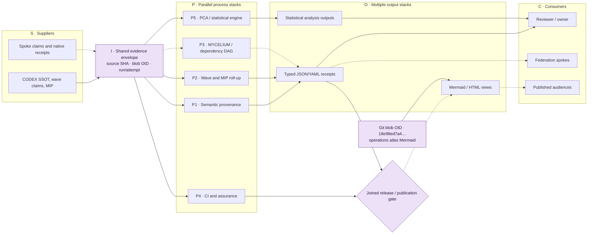
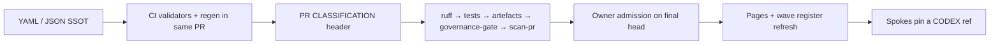
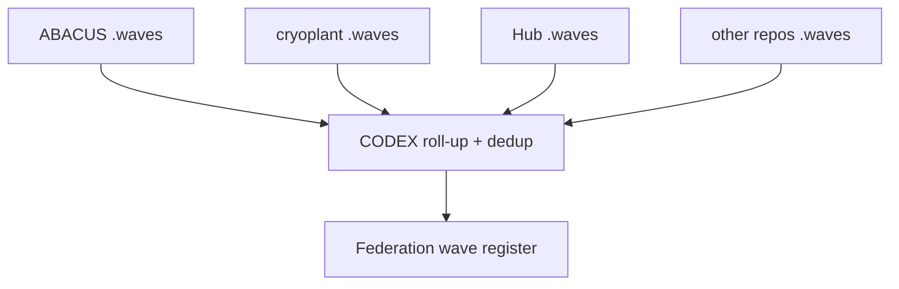

# CODEX — KEB semantic-provenance and governance plane

<!-- markdownlint-disable MD001 MD013 MD022 MD029 MD031 MD032 MD033 MD040 MD060 -->

<!-- OG5_VISUAL_FRONTDOOR_BEGIN -->
## Visual front door · architecture, process DAG and OID

> **Scope:** repository topology and declared process contracts, **not** a current CI, dispatch, approval or engineering-acceptance receipt. Solid edges show source/data relationships; dashed edges are candidate federation handoffs or publication dependencies. Full cross-repo OID and lane views are owned by JADE in the Hub.



**Object identity and forest navigation:** [OID-linked operations atlas](docs/missioncontrol_operations_atlas_v2.mmd) (recorded Git blob `18e98ed7a4929a11278629be25c75fc78595871d`) · [Mycelium interactive HTML](docs/missioncontrol_mycelium.html) · [Graph explorer](docs/missioncontrol_graph_explorer.html) · [existing Pages portal source](docs/index.html) · [JADE function/SHA/OID federation lens](https://github.com/GBOGEB/pipeline-automation-hub/blob/master/mission-control/jade_temple/site/cicd_dag.html) · [seven-lane/70-stage canonical matrix](https://github.com/GBOGEB/pipeline-automation-hub/blob/master/tools/metric-atlas/docs/LANE_PROCESS_GRAPH_W380.md). The OID labels a *Git file object*, not a running process. Pages publication/served-byte validation remains a distinct gate.

<!-- OG5_VISUAL_FRONTDOOR_END -->


[](docs/api/metrics.json)
[](https://github.com/GBOGEB/CODEX/actions/workflows/ci.yml)
[](.github/workflows/ci.yml)
[](pyproject.toml)
[](LICENSE)

> **CODEX keeps the federation honest about where a fact came from: it owns semantic provenance, federation contracts, publication and the automation that every other repository imports instead of copying.**

## At a glance

| | |
|---|---|
| **Domain** | KEB semantic/provenance runtime (`.mesh/MESH_DOCK.yaml`: `KEB_SEMANTIC_PROVENANCE_RUNTIME`), federation contracts, GitHub automation and the human-facing Pages portal |
| **EPICs carried here** | **DMAIC wave control** ([#319](https://github.com/GBOGEB/CODEX/issues/319)) · **QPS KEB coverage** ([#324](https://github.com/GBOGEB/CODEX/issues/324)) and **v6 publication lane** ([#753](https://github.com/GBOGEB/CODEX/issues/753)) · **CODE PURPLE** control ([#989](https://github.com/GBOGEB/CODEX/issues/989), [#991](https://github.com/GBOGEB/CODEX/issues/991), [#1037](https://github.com/GBOGEB/CODEX/issues/1037)) · **MissionControl dispatch** ([#879](https://github.com/GBOGEB/CODEX/issues/879), [#977](https://github.com/GBOGEB/CODEX/issues/977)) · **MYCELIUM** ([#1088](https://github.com/GBOGEB/CODEX/issues/1088), [#1199](https://github.com/GBOGEB/CODEX/issues/1199)) · **U-series** workstation and CI follow-ups ([#1198](https://github.com/GBOGEB/CODEX/issues/1198)–[#1288](https://github.com/GBOGEB/CODEX/issues/1288)) |
| **Owner and decision authority** | Repository owner **GBOGEB** ([CODEOWNERS](.github/CODEOWNERS)): admission to `main`, releases, Pages publication and every external grant. No agent, bot or CI verdict holds this authority. |
| **Role in the federation** | The *governance plane*: it defines the contracts, wave register and MIP kit the other repositories consume; it does not run QPS engineering or own runtime analysis. |
| **Owns** | Federation contracts and semantic index, the wave naming ruleset and federation roll-up, the MIP kit, canonical Bradley–Terry/PCA (`pca_engine/`), the MASTER Contract Workbench automation, MissionControl receipts, the `codex` GitHub-interface package, Pages |
| **Does not own** | Contract data and the DOW runtime (ABACUS) · QPS engineering SSOT, OCD/ADR and release identity (cryoplant-project) · Kahn scheduling and the JADE census (Hub) · numerical method research (gg_MATH) |
| **Status snapshot** | `main@e4e28ae`, read 15 November 2026 — 19 open issues, 8 open PRs. [Details and closure proofs ↓](#6-status-and-open-gates) |

**New here?** Read [§1](#1-why-codex-exists--bios) (2 min), then the route that matches you:

| I want to… | Open this first |
|---|---|
| Understand identity, operating model and workflow lanes | [`GOVERNANCE.md`](GOVERNANCE.md) and [BIOS](#1-why-codex-exists--bios) |
| Use the canonical Bradley–Terry / PCA engine | [`pca_engine/CANONICAL_API.md`](pca_engine/CANONICAL_API.md) |
| Declare or validate my repository's waves | [What is inside](#3-what-is-inside) → wave register and MIP kit |
| Work with contract follow-up data | [MASTER Contract Workbench](MASTER_input/README.md) |
| Install the `codex` package or run the checks | [Run it locally](#7-run-it-locally) |
| Know what is open and what would close it | [Status and open gates](#6-status-and-open-gates) |
| Contribute a PR that passes the governance gate | [`CONTRIBUTING.md`](CONTRIBUTING.md) — every PR body starts with `## PR CLASSIFICATION` |

## 1. Why CODEX exists — BIOS

**B — Baseline.** CODEX is a governed federation-runtime repository ([`GOVERNANCE.md`](GOVERNANCE.md) §1): CI is the truth-verification gate, Pages is the human portal, DMAIC is the iteration ledger, and bridge/federation outputs are the measurable integration layer.

**I — Identity and integrity.** Manifests, lineage, DMAIC phase maps and bridge contracts have one source here. YAML SSOT governs; Excel, HTML and dashboards are generated views whose edits must come back as change requests.

**O — Orchestration with ownership.** "ABACUS owns contract data. CODEX owns automation." Spokes import CODEX's canonical code (for example `pca_engine`, the MIP kit, reusable workflows) rather than keeping divergent copies.

**S — Safety and source-qualified status.** Tooling success is never engineering, compliance or acceptance authority ([`AGENTS.md`](AGENTS.md)). A test stage that runs zero tests is a failure. CODEX is public: content from private handover archives lands in a private repository first and is promoted file by file after review.

**Who uses it:**

| Reader | Comes for | Leaves with |
|---|---|---|
| External visitor | What the federation's governance plane does | This page, [`GOVERNANCE.md`](GOVERNANCE.md), live [issues](https://github.com/GBOGEB/CODEX/issues) |
| Spoke repository maintainer | Contracts, wave rules, MIP kit, reusable workflows | A pinned CODEX ref to import |
| Engineer | Change automation or contracts and prove it | A feature branch, native CI, a classified PR |
| Agent session | Operating rules | [`CLAUDE.md`](CLAUDE.md) and [`AGENTS.md`](AGENTS.md) |
| Owner | Decide admission and publication | A PR whose required checks are green on the final head |

**Where authority lives:** [`GOVERNANCE.md`](GOVERNANCE.md) (identity, workflow → lane map, CI-vs-CD contract) · [`.mesh/MESH_DOCK.yaml`](.mesh/MESH_DOCK.yaml) (federation role) · [`GLOB.yaml`](GLOB.yaml) and [`GLOB_POLICY.md`](GLOB_POLICY.md) · [`BACKBONE_POLICY.md`](BACKBONE_POLICY.md) · [`.waves/WAVE_CLAIMS.yaml`](.waves/WAVE_CLAIMS.yaml).

## 2. From source to decision

1. **Declare at the source.** A contract, wave claim or SSOT record is written once, in YAML/JSON under version control.
2. **Validate.** Schema, manifest, glob, link and staleness checks run in CI; generated artefacts are regenerated in the **same** PR as the change that invalidates them.
3. **Classify the PR.** The `## PR CLASSIFICATION` header (PR-ID, wave, sprint, domain, type, criticality, topology impact, schema mutation) is parsed by the governance gate.
4. **Triage red in order:** ruff → tests → artefact validators → governance-gate → scan-pr. Fix the earliest failing stage first.
5. **Admit.** Required checks green on the final head; owner merges.
6. **Publish and roll up.** Pages and the federation wave register are refreshed from `main`; spokes consume a pinned ref.

## 3. What is inside

| Block | Native source | Input → output | Boundary |
|---|---|---|---|
| Governance runtime | [`GOVERNANCE.md`](GOVERNANCE.md), [`federation_runtime/engines/governance_parser.py`](federation_runtime/engines/governance_parser.py) | PR body + check outcomes → governance snapshot | Governance green ≠ engineering acceptance |
| Wave register and roll-up | [`.waves/`](.waves/WAVE_CLAIMS.yaml), [`MIP/`](MIP/README.md) | Per-repo wave claims → deduplicated federation census | Each repo names its own waves; CODEX only rolls up |
| MIP kit | [`MIP/kit/`](MIP/kit/KIT_MANIFEST.json), [`mip_kit_manifest.py`](scripts/mip_kit_manifest.py) | Kit release → consumer repos pin `CODEX_KIT_REF` | Validator, not owner of consumer waves |
| Canonical statistics engine | [`pca_engine/`](pca_engine/CANONICAL_API.md) | Pairwise comparisons / data matrix → Bradley–Terry ranks, PCA/NLPCA | Domain-neutral; no trading or QPS authority logic |
| Semantic index and drift | [`federation/semantic_index/schema.yaml`](federation/semantic_index/schema.yaml), [`telemetry/pca/drift_monitor.py`](telemetry/pca/drift_monitor.py) | Baseline + current metrics → drift report | Drift is a signal, not a verdict |
| MASTER Contract Workbench | [`MASTER_input/`](MASTER_input/README.md), [`generate_contract_workbench.py`](scripts/generate_contract_workbench.py), [`check_contract_workbench.py`](scripts/check_contract_workbench.py) | YAML SSOT → Excel, HTML, trace report, dashboard, checkpoint | Generated outputs are non-authoritative; released ITT baseline is locked |
| MissionControl | [`mission_control/`](mission_control/), [`regen_missioncontrol_inventory.py`](scripts/regen_missioncontrol_inventory.py) | Tests, workflows, scripts → inventory receipts | Receipts must be regenerated when inventory changes |
| `codex` package | [`src/`](src/__init__.py), [`pyproject.toml`](pyproject.toml) | Config → GitHub.com / Enterprise Server API client and auth helpers | Library only |
| Repository checks | [`check_manifest.py`](scripts/check_manifest.py), [`check_globs.py`](scripts/check_globs.py), [`check_links.py`](scripts/check_links.py), [`check_stale.py`](scripts/check_stale.py), [`ruff_ratchet.py`](scripts/ruff_ratchet.py) | Tree → pass/fail with named findings | Unreadable or wrong-version output is `UNKNOWN`, never a pass |
| Pages portal | [`docs/index.html`](docs/index.html), [`docs/api/metrics.json`](docs/api/metrics.json) | Verified, manifest-registered HTML → public portal | Only manifest-registered pages publish |

## 4. Where CODEX sits in the federation

| Repository | Keeps authority for | CODEX interface |
|---|---|---|
| [ABACUS](https://github.com/GBOGEB/ABACUS) | Contract data, DOW runtime, first-red CI repair | Pins the MIP kit; publishes the same metrics schema |
| [cryoplant-project](https://github.com/GBOGEB/cryoplant-project) (private) | QPS engineering SSOT, OCD/ADR, release identity | Publication lane [#753](https://github.com/GBOGEB/CODEX/issues/753); no cryoplant content is mirrored here |
| [pipeline-automation-hub](https://github.com/GBOGEB/pipeline-automation-hub) (`master`) | Mission Control, Kahn scheduling, JADE census | Reusable receiver workflows; census inputs |
| [gg_MATH](https://github.com/GBOGEB/gg_MATH) | Numerical kernels and uncertainty methods | Method references |
| [GEMINI](https://github.com/GBOGEB/GEMINI) | Cross-agent handover contracts | Ecosystem dispatch target |

Hub-and-spoke map and the public/private boundary: [`GBOGEB/ABACUS:docs/integration/CROSS_REPO_MAP.md`](https://github.com/GBOGEB/ABACUS/blob/main/docs/integration/CROSS_REPO_MAP.md). Flagged items: [`PRUNE_CANDIDATES.md`](PRUNE_CANDIDATES.md).

## 5. Process diagrams

Declared architecture, not an execution receipt.





## 6. Status and open gates

**Snapshot: `main@e4e28ae`, read 15 November 2026.** Rows point at live owners; open the link for the current position.

| Gate | Status | What would close it |
|---|---|---|
| `main` protection | **Ruleset active**: pull request required; required checks *test*, *governance-validation*, *runtime-validation*, *release-readiness*, *self-smoke (3.11)*, *self-smoke (3.12)*. **0 required approvals.** Bots publish through PRs, never direct pushes. | Owner decision on review requirements, read back from the ruleset |
| MIP kit | **1.3.3** merged ([#1299](https://github.com/GBOGEB/CODEX/pull/1299)); 1.3.4 open ([#1308](https://github.com/GBOGEB/CODEX/pull/1308)) | 1.3.4 green and merged; consumers bump `CODEX_KIT_REF` |
| Wave register | Naming ruleset, per-repo claims and roll-up merged ([#1248](https://github.com/GBOGEB/CODEX/pull/1248)); slice 2 elevated 36 federation ids ([#1301](https://github.com/GBOGEB/CODEX/pull/1301)) | Remaining repos declare roles; planned-but-unstarted waves decided ([#1198](https://github.com/GBOGEB/CODEX/issues/1198)) |
| Ruff ratchet | Pinned `ruff==0.16.6`, ratchet against [`ci/ruff_baseline.json`](ci/ruff_baseline.json) since 8 Nov | Baseline lowered in each PR that fixes violations |
| Strict-xfail defects | [#1287](https://github.com/GBOGEB/CODEX/issues/1287): 16 production defects from coverage lane L3; slice 1 open ([#1294](https://github.com/GBOGEB/CODEX/pull/1294)) | Each defect fixed and its xfail removed |
| CODE PURPLE admission | [#991](https://github.com/GBOGEB/CODEX/issues/991) HOLD — independent security reviewer needed; [#1037](https://github.com/GBOGEB/CODEX/issues/1037) post-merge reader | Independent review recorded; first-reds repaired and recensused |
| Mycelium CI | [#1199](https://github.com/GBOGEB/CODEX/issues/1199) red; federation return path to replace `repository_dispatch` | Green run plus a working return path |
| QPS v6 publication | [#753](https://github.com/GBOGEB/CODEX/issues/753) open | Sanitized Pages projection and release provenance returned to cryoplant-project |

## 7. Run it locally

The CI `test` job runs on **Python 3.12**; *self-smoke* covers **3.11** and **3.12**. `pyproject.toml` declares `>=3.11`.

```bash
git clone https://github.com/GBOGEB/CODEX.git
cd CODEX
python -m pip install -e '.[dev]'
python -m pytest                     # testpaths = tests, xfail_strict = true
python scripts/check_manifest.py
python scripts/check_globs.py
python scripts/check_stale.py
python scripts/check_links.py
```

Use the `codex` package (GitHub.com or Enterprise Server):

```python
from src import GitHubAuthenticator, GitHubInterface

interface = GitHubInterface()                       # or base_url="https://github.company.com", enterprise_mode=True
authenticator = GitHubAuthenticator(interface)
print(interface.api_url, interface.test_connection())
```

Regenerate the contract workbench from its YAML SSOT:

```bash
python scripts/generate_contract_workbench.py
python scripts/check_contract_workbench.py
```

Adding or removing a test, workflow, script or module? Run `python scripts/regen_missioncontrol_inventory.py` and commit the receipts in the same PR. Local runs are a development path, not native CI.

## 8. Evidence rules and non-compensation

- CI status is reported as passed / failed / skipped / not-required; a green tick alone is not evidence.
- Zero tests run is a failure. A ruff version other than the pin, or unreadable output, is `UNKNOWN` (exit 3).
- Generated artefacts (RTM/SSOT, Excel, HTML) regenerate in the same PR as their source change; render baselines change only in their own justified commit.
- CODEX is public: never commit `.env`, tokens or unreviewed archive content; bidder names, contract values and personal data stay in private repositories.
- Full operating rules: [`GOVERNANCE.md`](GOVERNANCE.md), [`AGENTS.md`](AGENTS.md), [`CLAUDE.md`](CLAUDE.md). Report vulnerabilities via [`SECURITY.md`](SECURITY.md).

<details>
<summary>MASTER Contract Governance Workbench rules</summary>

The workbench lifecycle runs from selection and ITT through clarification, negotiation rounds, BAFO and award to execution; phase definitions live in [`contract.yaml`](MASTER_input/contracts/master-contract/contract.yaml), whose `governance.owners` assigns **Lifecycle State to ABACUS**. At this snapshot neither CODEX nor ABACUS holds a source-qualified current-stage record, so this page states no current stage; adding that record in ABACUS is an open owner action.

1. `MASTER_input/00_ITT_RELEASE_BASELINE/` is locked baseline material; released ITT documents are never overwritten.
2. All updates are additive; YAML SSOT is authoritative.
3. Excel, HTML, dashboards and reports are generated outputs only; edits to them become change requests back into SSOT.
4. Lineage is preserved from source document → requirement → clarification → applicant response → evaluation → negotiation → BAFO → award → execution deliverable.
5. Generated payloads (`MASTER_input/generated/`) and checkpoints (`MASTER_input/checkpoints/`) are git-ignored; the guard proves deterministic regeneration by comparing manifests and SHA-256 hashes from two temporary generations.

</details>

## 9. Repository map and next actions

| Source | Why open it |
|---|---|
| [`GOVERNANCE.md`](GOVERNANCE.md), [`AGENTS.md`](AGENTS.md), [`CLAUDE.md`](CLAUDE.md) | Identity, operating model, agent rules |
| [`federation/`](federation/), [`federation_runtime/`](federation_runtime/) | Federation contracts and governance engines |
| [`.waves/`](.waves/WAVE_CLAIMS.yaml), [`MIP/`](MIP/README.md) | Wave claims, MIP kit |
| [`pca_engine/`](pca_engine/CANONICAL_API.md) | Canonical Bradley–Terry / PCA |
| [`MASTER_input/`](MASTER_input/README.md) | Contract workbench SSOT |
| [`mission_control/`](mission_control/) | MissionControl inventory and receipts |
| [`scripts/`](scripts/), [`tests/`](tests/), [`src/`](src/__init__.py) | Automation, tests, `codex` package |
| [`docs/`](docs/index.html) | Pages portal source and metrics |
| [`CHANGELOG.md`](CHANGELOG.md) | Change history |
| [Issues](https://github.com/GBOGEB/CODEX/issues), [pull requests](https://github.com/GBOGEB/CODEX/pulls), [Actions](https://github.com/GBOGEB/CODEX/actions) | Live queue, PR heads and CI evidence |

**Next governed actions, in order:**

1. Land MIP kit 1.3.4 ([#1308](https://github.com/GBOGEB/CODEX/pull/1308)) and let consumers bump their kit ref.
2. Work the strict-xfail production defects ([#1287](https://github.com/GBOGEB/CODEX/issues/1287)), starting with [#1294](https://github.com/GBOGEB/CODEX/pull/1294).
3. Get Mycelium CI green and replace `repository_dispatch` with a return path ([#1199](https://github.com/GBOGEB/CODEX/issues/1199)).
4. Close the CODE PURPLE admission HOLD with an independent security review ([#991](https://github.com/GBOGEB/CODEX/issues/991)).
5. Decide each planned-but-unstarted wave ([#1198](https://github.com/GBOGEB/CODEX/issues/1198)).
6. Re-cut this status snapshot at the new `main` SHA when any of these moves.

---

**BIOS:** KEB semantic provenance + federation governance and automation. **Release authority:** repository owner. **Source licence:** [Apache-2.0](LICENSE), GBOGEB as source generator and owner. **Landing:** R2 of the [shared skeleton](https://github.com/GBOGEB/GEMINI/blob/main/docs/landing/LANDING_SKELETON.md), cut at `main@e4e28ae` on 2026-11-15.
