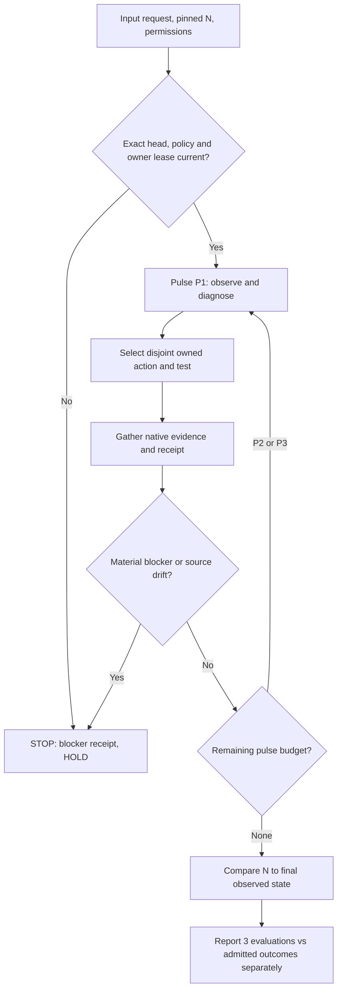

# CODE PURPLE G3A — governed three-step advancement

Status: **execution protocol / advisory until verified by native checks and owner review**.
Canonical vocabulary: [CODEX glossary](../reference/glossary.yaml), `glossary.execution_units`.
Existing control records and admission owners remain in ABACUS MIP/CI and the governed repository rulesets. This file is not a new federation SSOT and does not grant authority.

## Wave versus pulse

- **Wave (W):** outcome-delivery campaign, planned/owned against DoV. May contain multiple pulses and disjoint worker slices.
- **Pulse (P):** one evidence-bound DMAIC/MIP sequence: observe -> diagnose -> select admissible action -> act -> verify -> classify and append receipt.
- **Slice (S):** disjoint owner/file domain inside a pulse or wave. Read-only scouts may fan out; writes are owner-leased.
- **G3A:** one bounded **N to planned N+3** engagement, three *sequential pulses* (the default interpretation of "next 3").
- **G3W:** three independently dispositioned **waves**, each possibly requiring several pulses. Never silently replace G3A with G3W.
- **N:** a pinned observation tuple, not a PR number or a count of commits. Include exact repo, branch and head/main SHA, policy/config hash, timestamp and denominators.

## Request packet and one-command shorthand

At invocation the operator supplies: objective/DoV, repository/PR scope, starting evidence SHA, policy/config identity, source-owner constraints, time/CI/worker budget, allowed action class, mandatory stop conditions and report destination. Where the target is underspecified, select the highest-value *admissible* first-red/coverage opportunity, not the loudest downstream symptom.

```text
G3A CODE_PURPLE
Goal: advance from fresh pinned N toward N+3 in three sequential DMAIC/MIP pulses.
Scope: GBOGEB/ABACUS PR #1980, stacked proof PR #2109; read CODEX canonical glossary.
Priority: first independent source-bound red, evidence quality, test and branch coverage.
Workers: at most four read-only scouts; disjoint file-owner write slices; one integrated exact-head testflight after fan-in.
Authority: inspect, measure, test, bounded owned edits, commits and draft PRs.
No merge, approval, security waiver, ruleset relaxation, force push, or fabricated reviewer.
On major blocker: STOP, preserve history, emit HOLD receipt and actionable unblock.
Return once with planned/actual actions, SHA changes, tests, numerator/denominator,
runner wait/wall cost, first-red groups, admission gates, remaining backlog and next action.
```

This is an *instruction to an interactive execution agent within its current invocation*, not a claim that the Python reconciler below can access GitHub or continue asynchronously after it returns.

## State machine and DAG



An optional wave may contain parallel **read-only** scouts and nonoverlapping **write** slices. A pulse never outranks independent security, governance, A10, required-status, CODEX protection or human review gates.

## SIPOC and state transitions

| Supplier | Input | Process | Output | Consumer |
| --- | --- | --- | --- | --- |
| Operator and repo owner | Mission/DoV, permitted actions, owner leases | Validate request and risk bounds | Accepted G3A packet or STOP | CODEX orchestration |
| GitHub + ABACUS | Exact head/main SHA, runs, logs, coverage, artifacts | Classify first reds and missing proof | Source-bound diagnostic queue | Disjoint repair owners |
| Owned implementers | Explicit task slices and immutable parent SHA | Change/test in disjoint scopes, fan in once | Commits, native jobs, failure/coverage metrics | ABACUS evidence |
| Governance/review owners | Native full-gate checks, security, A10, independent review | Accept, reject or hold each gate | Non-fabricated admission and next baseline | Operator/federation |

Per-pulse states: `PLANNED -> OBSERVED -> DIAGNOSED -> ACTED -> VERIFIED -> DISPOSITIONED`. If testing cannot execute, use `NOT_RUN` and `HOLD` instead of `PASS`. A run that merely finishes P3 has **three evaluated pulses**, not automatically three verified improvements or merges.

## Adaptive decision rule

1. Refresh PR head/main and policy/config identity *before each pulse*; invalidate stale proofs. Preserve failed historical runs without substituting them for current head.
2. Join terminal job/step logs and artifact bytes, distinguish first-independent-red from propagated summary failure. Do not treat 260 failing jobs as 260 causal roots.
3. Rank candidates by evidence-backed unblock reach, severity, root recurrence, changed-line/branch coverage deficit, owner availability, measured test cost and dependency. Label all estimated/unknown quantities.
4. Select at most one owner per write path. Allow scout parallelism; never perform overlapping source writes or re-run superseded CI heads.
5. Run native preflight, owned mutation if allowed, focused tests, external/hosted checks where available, and full admission check if claiming admission.
6. Append an immutable pulse receipt with previous/current SHA, planned/actual, first-red, tests, coverage numerators/denominators, timings, artifacts and block reason.
7. Select next admissible action based on the actual pulse result. If a major blocker appears, stop early and report progress already earned.

## Mandatory stop and non-authority boundaries

Stop on head/policy drift, P0/P1 security uncertainty, missing source owner/permissions, conflicting write lease, untrusted/missing required artifact evidence, exhausted budget or other material blocker. An isolated deterministic noncritical red can become the next pulse's repair target; never waive it automatically. No automatic merge, self-review, A10 disposition, security suppression or branch-protection change.

Read-only contract checker: `python scripts/g3a_protocol.py --plan request.json --receipts pulse_receipts.json --output g3a_report.json`. It checks three-pulse bounds, declared action permissions, disjoint slices, SHA/policy continuity, check references, and major-blocker stops. **It does not dispatch tasks, authenticate GitHub, verify external artifact bytes, run native tests or promote merge admission.** Its outputs always retain `merge_admission=HOLD` and `external_proof_required=true`.

## Receipt and final answer

The machine packet uses `code-purple.g3a.request.v1`, `code-purple.g3a.pulse.v1`, and `code-purple.g3a.reconciliation.v1`. Public receipts should contain reviewed, nonsensitive summaries. Independently verify GitHub run/check identities and ZIP SHA-256/digests *outside* the reconciler before awarding proof. For every pulse report:
- pulse ID and intended vs actual action, owner lease and file scope;
- source and policy SHA before/after, base/main SHA and effective run IDs;
- tests planned/run/passed/failed/skipped with case/line/branch denominators;
- root hypothesis and first-red attribution with evidence pointers;
- queue, checkout, setup, execution and wall times separately;
- source status `IMPLEMENTED | LOCAL_VERIFIED | HOSTED_VERIFIED | HOLD | BLOCKED`;
- open risks, deferred findings and independent admission state.

Final verdict must distinguish `3/3 evaluated`, `x/3 native verified`, `y/3 accepted`, and `merge admitted/withheld`. If a blocker stops at P1 or P2, write a partial stop receipt and state the missing authority or evidence; do not claim N+3 acceptance.

## Relation to existing owners

- **CODEX:** terminology, cross-repo scheduler/selection protocol, mission packet and safe reconciliation.
- **ABACUS:** native execution evidence, MIP receipt and first-red/CI checks; source of admission evidence.
- **QPS/engineering owners:** application-level requirements, technical DoV and disposition.
- **Human owner and protected workflow:** security, A10, independent review and merge authority.
