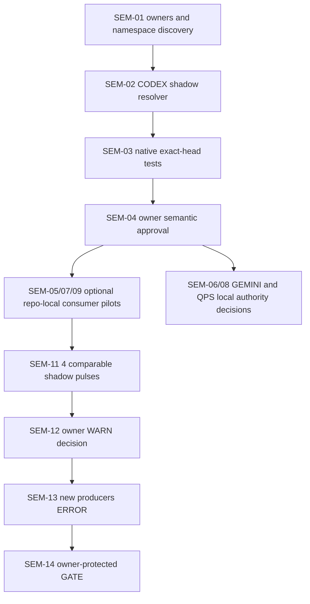

# P0007 — global semantic alias convergence without breaking passing code

**Status:** DRAFT / SHADOW_NO_DISPATCH / owner review pending. **Baseline:** CODEX `main@28fb5f381057d154b0f3a7a4272f2c0336304ae6` (2026-11-10). This document augments the canonical [global action taxonomy](GLOBAL_ACTION_TAXONOMY_v1.yaml) and [global glossary](GLOBAL_GLOSSARY_v1.yaml); it is **not** a new glossary, a global scheduler or an authority transfer.

## Why this exists

Different agents, scripts, operators and repos use different words for similar work. Some shorthand is valuable; some appears equivalent but changes the required evidence or decision authority. The goal is **deterministic routing for explicitly registered synonyms**, a measured and reversible warning-to-error-to-gate migration for deprecated spellings, and no involuntary retitling, folder moves or rewrite of passing source.

The [source-bound shadow alias profile](PROMPT_ALIAS_SHADOW_PROFILE_v1.json) is a *consumer registry* of **10 existing CODEX action monikers plus 2 existing composite selectors**, not a replacement taxonomy. [Resolver](prompt_alias_shadow.py) only returns a candidate action receipt with `dispatch_authorized=false`. It checks the Git blob OIDs of the two canonical owners and fails closed on drift, duplicate aliases, reserved status codes, ambiguous method abbreviations, unknown phrases and non-ASCII lookalikes. This is **not a guarantee about arbitrary free-form prompts**: phrases not on the allowlist need explicit clarification or a governed classification step.

## Namespace and authority crosswalk (exact observed sources)

| Repo/role | Current source anchor | Canonical authority / explicit non-alias |
|---|---|---|
| **CODEX KEB / global routing** | `federation/mesh/GLOBAL_ACTION_TAXONOMY_v1.yaml`, `GLOBAL_GLOSSARY_v1.yaml`, `governance/mesh/MESH_STATUS_CONTRACT_v1.yaml` at `28fb5f38` | `CLOSE/RED/SEM/SSOT/RECEIPT/WATCH` are action monikers; `CG/RR/CR/SR/DR/PB/FE/QH/HK/BG/KR/EX/WD` are **status dimensions**. W111 dual-use short aliases are historical-only, **never operational action synonyms**. |
| **Hub / PAH / Mission Control** | `mission-control/v2/MC_GLOSSARY_TAXONOMY_v2.json`, `mission-control/issue_rank/title_taxonomy.py` at `master@401c5731`; active W0 #1135 | Hub title parser remains the **only title parser**; its action prefix `fix/docs` is **not** a CODEX mesh action. A title, branch, issue comment, or source green cannot be inferred as closure. Hub B01–B38 namespace is separate from BridgeFlow `BR02-xx`. |
| **ABACUS / DOW execution** | `MIP/GCA3_GLOSSARY_AND_PROTOCOL.md` at `main@89d5daeb` | WAVE = accepted engineering increment; PULSE = observe/diagnose/verify; ADVANCE = scoped accepted checkpoint. **3P*** method stages are not three pulses, **3PC** classification and **3PR** re-entry remain distinct. |
| **GEMINI / GMI proposal broker** | `docs/bridge/PACKAGE_CONTRACT.md`, `src/proposal_broker.py`, #44 and #52, `main@d3a885ab` | `profile + proposal` and historical `proposal_profile` are **not aliases**. Legacy package collision must classify `AMBIGUOUS_LEGACY_PROFILE` before artifact census. `CHANGED` versus rejected idempotency remains owner-decided. Hosted IC3 is not manual Drive read. |
| **QPS / cryoplant child authority** | `qps/glossary/QPS_GLOSSARY_MODEL_v0.1.yaml` at `main@e865d7f9` | Contract Addendum II and SCK CEN defined terms outrank applicant ALAT/LKT then general. `QPLANT` is a subsystem view, not an interchangeable contractual QPS name. ALAT/LKT aliases may not combine bidder-specific facts. |
| **gg_MATH / numerical methods** | `main@72c4dbbf`, method and kernel source | Mathematical names like PCA, BT, confidence intervals and rank probabilities require a method-specific, parameter-and-evidence-bound adapter; no universal synonym may silently turn PCA into NLPCA or BT into a different estimator. |

The crosswalk is **read-only reconnaissance**. Owner files in other repositories are not changed by this draft. Local Windows/PowerShell worktrees have **not** been accessed or renamed. Their source-of-truth changes require per-repo path-owner PRs and original test suites.

## Vocabulary: disambiguations that matter for admission

| Terms users may mix | Stable distinction | Action |
|---|---|---|
| DoD vs DoV | Source/implementation completion versus independently qualified evidence and scope acceptance | Always keep separate fields |
| DONE vs MERGED vs FPC GREEN vs OWNER_ACCEPTED | Checklist, Git integration, required status and actual authority are different state dimensions | Never normalize into a single PASS |
| W1/W2 `P1/P2/P3` vs ABACUS `3P*` | GM-I-C PR pulse protocol vs MIP-method stages; `3P*` is not an alias for 3MP | Require namespace/context |
| first-red vs root-red vs EVERRED | First observed failure, causally diagnosed root and recurrence census differ | Separate source and evidence |
| `CG` historical action name vs `CG` status | CODEX W111 collision already repaired | Reject as action shorthand |
| `BDQ` Hub and BridgeFlow | Two ledgers with independent IDs and overlapped evidence | Crosswalk by root/source; never add raw counts |
| `IC3` root read vs hosted proof | Owner connector sees children but no service-account WIF proof | Use exactly `IC3_DRIVE_READONLY_GT0_STEP_PASS` only after hosted run |
| QPS vs QPLANT and ALAT vs LKT | Contract authority/subsystem and applicant partitions | Preserve local authority; no collapsing |
| DAG vs execution vs SIPOC | Graph prerequisites, selected implementation actions and supplier-input-process evidence boundary are different views | Different labeled artifacts |

## Prompt aliases kept **for value** — explicit allowlist, stable receipts

| Canonical CODEX route | Productive accepted phrasings | Output guarantee |
|---|---|---|
| `RED` | “recurse first red”, “repair first blocker”, “first red repair” | Same `gbogeb.mesh.action-intent-candidate.v1` payload and hash |
| `SEM` | “semantic convergence”, “align terminology”, “repair semantic drift” | Same action ID, no schema/source authority change |
| `RECEIPT` | “bind receipt”, “prove exact head” | Same exact-SHA evidence *request*, no fabricated proof |
| `CLOSE` | “close current gate”, “finish current gate” | Same candidate; acceptance/issue closure still owner-gated |
| `G3A` **composite** | “next ambitious slice”, “bounded next three advances” | Same bounded mission **proposal**, not a CLOSE action or background execution |
| `MESH_CLOSURE_CONTROL` **composite** | “mesh closure control this”, “continue governed closure” | Same selector candidate; non-compensating gates preserved |

**Guarantee boundary:** aliases are matched as exact phrases after conservative ASCII lowercasing, whitespace normalization and approved punctuation folding. The route payload excludes the original phrase, so equivalent aliases produce *byte-identical, digest-identical* canonical intent candidates. Diagnostics (e.g. warning about old spelling) remain outside that payload. Different inputs, ambiguous phrases, free-form sentence suffixes, namespace collisions, and missing scopes are *not* silently coerced to the same action.

## Soft-refactor / de-alias lifecycle — no unapproved automatic gate

| Stage | Behavior | Minimum admission evidence |
|---|---|---|
| S0 **CENSUS** | Read-only old and new term inventory, classify false friends and legitimate shortcuts | Source SHAs, where-used pointers, owner per field, measured denominators |
| S1 **SHADOW** (current) | Candidate resolver and negative canaries only; no renames, runtime dispatch or required gate | Deterministic test receipt at exact head; zero collision false passes |
| S2 **WARN** (owner opt-in) | Old *unambiguous* spellings still route identically; separate visible warning | Four comparable pulses; stable alias map; owner signoff |
| S3 **ERROR for new producers** (future) | New machine exports reject deprecated spellings; old consumers remain accepted temporarily where explicitly approved | Owner migration contract + at least 14 days of warning + producer canary |
| S4 **GATE** (future) | Only an owner-approved *existing required* gate may reject old spells after old consumers are migrated | At least 30 days nonbreaking compatibility, exact-head review, RED negative/positive canary and rollback |
| S5 **RETIRE** (future) | Remove deprecated machine spelling only after every consumer proves equivalence; retain provenance | Cross-repo source-bound acceptance, 0 unresolved compatible consumers |

Moving between stages is an **owner decision**, never an elapsed-timer automation. P0 collisions and source-authority violations already reject even in SHADOW. Historical immutable receipts and filenames do **not** get rewritten.

## Code health / semantic BD-queue (deduplicated by owner and source)

| ID | P | Status now | DoD / minimum DoV |
|---|---|---|---|
| SEM-01 | P0 | **DONE source discovery** | Resolve global action/status owner, Hub title parser, ABACUS execution meaning, GEMINI wire contract, QPS glossary, gg_MATH kernel boundaries |
| SEM-02 | P1 | **DONE candidate source** | CODEX shadow profile/strict resolver/negative suite on draft PR; no runtime side effects |
| SEM-03 | P1 | **CI_PENDING** | Exact-head CODEX native job collects >0 tests and all pass; no inherited green |
| SEM-04 | P0 | **OWNER_HOLD** | CODEX owner approves canonical action route and reserved status collision guard |
| SEM-05 | P1 | **OPEN** | Hub title-taxonomy consumer shows read-only where-used mapping; no parser fork, no auto-retitle |
| SEM-06 | P0 | **OWNER_HOLD** | GEMINI #44 profile/CHANGED owner agreement, historical collision contract tests and current native P2/P3 |
| SEM-07 | P1 | **OPEN** | ABACUS namespaced wave/pulse/3P*/G3A crosswalk with current runtime regression and no changed dispatch |
| SEM-08 | P0 | **OWNER_HOLD** | QPS SCK CEN terms authoritative, ALAT/LKT isolation; no engineering alias normalization without child signoff |
| SEM-09 | P1 | **OPEN** | gg_MATH mathematical notation and parameters checked; no PCA/BT model substitution from free-text aliases |
| SEM-10 | P1 | **OPEN** | Windows workstation/worktree path inventory with case, symlink, hashes and owner lease, **no mass moves** |
| SEM-11 | P1 | **OPEN** | Source-qualified shadow usage census (alias frequencies, unknowns, collisions, false routes) across four comparable pulses |
| SEM-12 | P1 | **OWNER_HOLD** | Explicit phase S2 warning owner decision; only then implement messaging in source-owner consumer |
| SEM-13 | P1 | **DEPENDENCY_HOLD** | S3 error ratchet for approved **new machine producers**, nonbreaking legacy clients |
| SEM-14 | P0 | **DEPENDENCY_HOLD** | S4 existing protected gate after owner acceptance and negative-canary qualification |
| SEM-15 | P2 | **OPEN** | Controlled documentation/pointer cleanup; no branch, PR, issue ID, folder or filename edits without independent compatibility tests |

**Count:** 15 semantic subitems = 2 candidate/source DONE, 1 CI_PENDING, 5 OPEN (SEM-05,07,09,10,11,15 = **6 OPEN**), 4 OWNER_HOLD (04,06,08,12), 2 DEPENDENCY_HOLD (13,14). These SEM IDs are **not new Hub B### IDs**; link them to the Hub cumulative burndown as subordinate evidence, without summing denominators.

## Incremental deployment DAG (Kahn-compatible)

**Stop rules:** No silent semantic drift; no confusable status and action aliases; no GitHub ruleset change, PR merge, issue closure, remote dispatch, or QPS contract mutation by this shadow profile. All historical aliases that add genuine value can be retained as permanent documented shortcuts when their canonical candidate and output stay stable.
